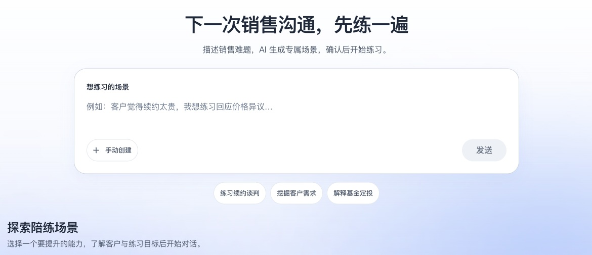

# 销练多多

AI 销售陪练与沟通复盘：描述销售难题，确认场景，与模拟客户交流，再从原话中找到下一轮要改的表达。

本项目在 [AWS 销售陪练开源样例](https://github.com/aws-samples/sample-ai-sales-roleplay)基础上进行本地化产品改造，当前运行版本使用 React、FastAPI 和 SQLite。`cdk/` 保留为原 AWS 实现参考。



## 先看产品

- **作品集**：[6 页图文案例](aidlc-docs/portfolio/2026-11-05/output/pdf/武禹德_销练多多_AI产品作品集.pdf)，包含真实页面截图、设计取舍、个人工作与验证边界。
- **产品演示**：启动前端后访问 `/demo`。可查看情境、两种模拟表达的示例复盘，再进入自己的练习。示例页面可在未登录、后端不可用时查看。
- **面试讲解**：[三分钟演示稿](aidlc-docs/construction/interview-demo-guide-2026-11-05.md)。
- **版本记录**：[本次更新](CHANGELOG.md)。

页面中的演示人物、产品和对话均为模拟案例或开发验收记录；示例评分不代表真实用户成长、培训效果或商业使用规模。

## 当前功能

1. **描述难题后生成场景**：AI 草拟客户、背景、目标和开场白，用户编辑确认后保存为私有场景；也可从内置场景库开始。
2. **语音或文字对练**：模拟客户、实时行为分析和独立目标判断分工；浏览器麦克风输入、说完了按钮及 NPC 语音播放。不要求摄像头。
3. **有原话依据的业务复盘**：五项行为量表采用 0/1/2 档位，程序检查消息 ID、说话人与引用，再按本场适用项及权重计算总分。证据不足时保持未评。
4. **从薄弱项进入专项复练**：新练习关联来源报告、选定考点和规则快照；条件可比时显示该考点的单次表现对照。
5. **统一管理真实沟通复盘**：支持粘贴聊天文字、导入 TXT，以及上传录音后由本地 Whisper 转写。用户核对销售/客户角色后生成报告；支持来源筛选和单条删除。
6. **运行控制**：SQLite 持久任务队列、租约恢复、失败重试、带来源的会话状态、受控工具、调用预算、鉴权和技术审计。

## 本地运行

需要 Node.js 22+、Python 3.11+。语音转写还需要 ffmpeg 和可用的本地 Whisper 模型。模型凭证与模型名从环境配置读取，不写入代码或仓库。

后端：

```bash
cd server
python -m venv .venv
source .venv/bin/activate
pip install -r requirements.txt
cp .env.example .env
# 编辑 .env：填写模型凭证、对话模型与复盘模型
# 本地调试可设 AUTH_DEV_BYPASS=1；对外部署必须关闭
uvicorn app.main:app --host 127.0.0.1 --port 8000
```

前端（另开终端）：

```bash
cd frontend
npm ci
cp .env.example .env
# VITE_LOCAL_BACKEND_URL=http://127.0.0.1:8000
# 本地调试如需自动登录，可设 VITE_DEV_BYPASS=1
npm run dev
```

打开 Vite 输出的地址，默认是 `http://127.0.0.1:5173`。如果端口改变，需要把实际前端来源加入后端 `CORS_ORIGINS`。本地地址不能供 HR 在其他电脑上直接访问。

首次启动会初始化数据库并导入场景；以后启动只补充缺失的精品场景，不覆盖既有场景、练习或报告。数据库和原始个人记录不随代码上传；升级前自行备份数据。

## 验证

前端单元测试与完整构建：

```bash
cd frontend
npm test -- --runInBand --silent
npm run build:full
npm run lint
```

后端离线回归（使用临时数据库与模型替身）：

```bash
cd server
source .venv/bin/activate
pip install -r requirements-test.txt
python -m unittest discover -s tests -v
python -m app.harness.evaluators.regression
```

自动化测试检查接口、状态、证据与计算等契约；合成案例实跑检查当次链路。两者都不能代替专家标注评测或证明实际培训效果。真实模型回归会产生调用费用，操作方式见[开发与验收记录](aidlc-docs/construction/harness/implementation-progress.md)。

## 实现结构

| 目录 | 当前职责 |
| --- | --- |
| `frontend/` | React 19、TypeScript、Material UI 7、Vite 8；场景、对练、复盘和演示页面 |
| `server/app/api/` | FastAPI 路由、登录、场景、会话、统一复盘及语音接口 |
| `server/app/harness/` | 服务端状态、共享上下文、工具权限、证据、预算与观测 |
| `server/app/services/` | 对话、业务评价、报告、导入复盘和专项复练 |
| `server/app/workers/` | 持久任务领取、租约、重试和过期结果保护 |
| `server/data/` | 场景种子；运行数据库保留在本地并由 Git 忽略 |
| `aidlc-docs/` | 设计、研究、验收与作品集材料 |
| `cdk/` | 原 AWS 参考实现，非当前本地后端 |

## 当前边界

- 评分规则是项目量表，仍需业务方确认和独立人工标注集校准；尚未完成真实企业班级试点。
- 尚无完整的培训师复核、申诉改判、班级任务与长期能力画像。
- 聊天暂不支持截图 OCR；录音需人工核对角色，原音不长期保存。文件上限与格式见[录音导入说明](aidlc-docs/construction/recording-import-2026-10-30.md)。
- PDF/幻灯片上传与视频分析未接入当前本地工作流；保留的旧组件不等于已开放能力。
- Worker 当前适合同机 SQLite；多机队列、全面负载验收与生产安全验收仍需后续工作。

## 部署与来源

[部署手册](部署手册.md)提供本地与 Docker Compose 方式。对外部署需要 HTTPS、随机 `JWT_SECRET`、明确的 CORS 来源、有效模型配置，并关闭两端开发免登录。仓库更新本身不会自动发布在线体验站点。

原样例采用 [MIT-0](LICENSE)；模型调用底座等参考组件的许可见 [第三方说明](THIRD_PARTY_NOTICES.md)。
