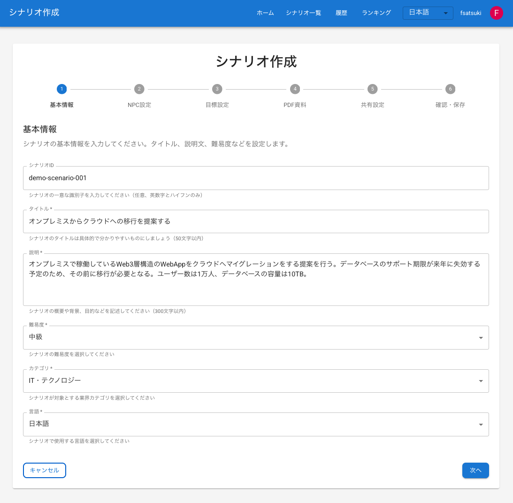
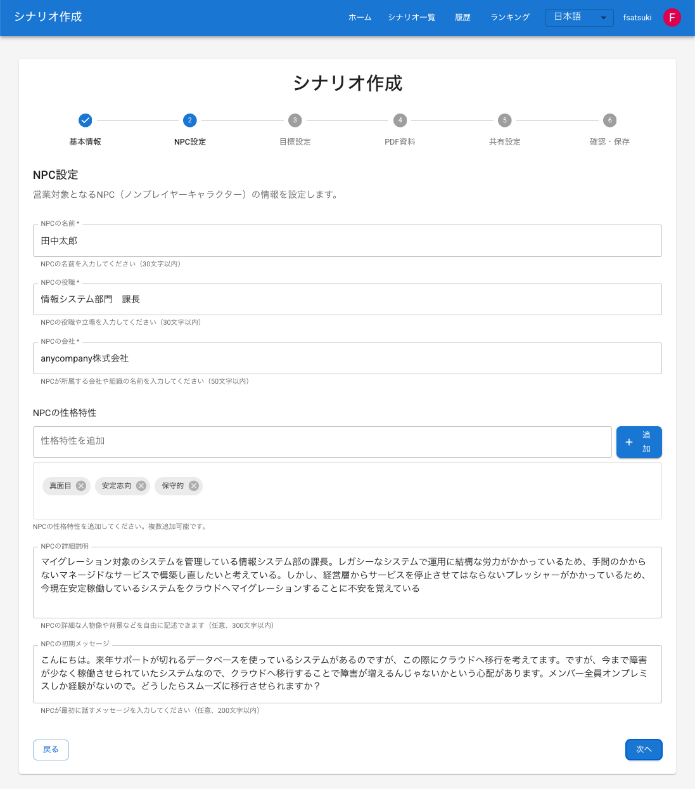
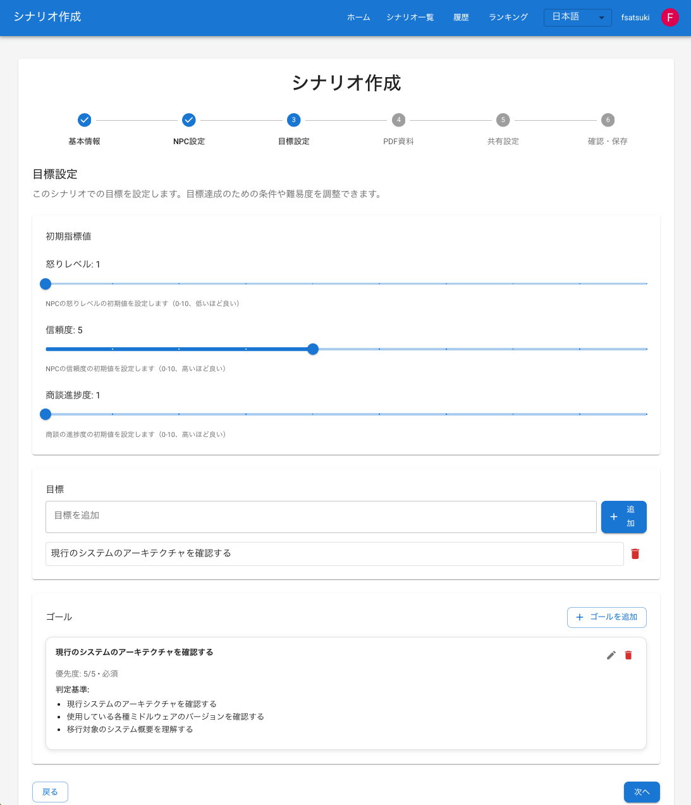
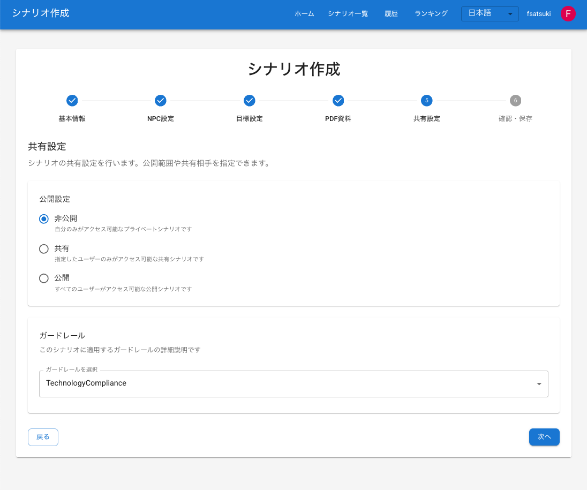
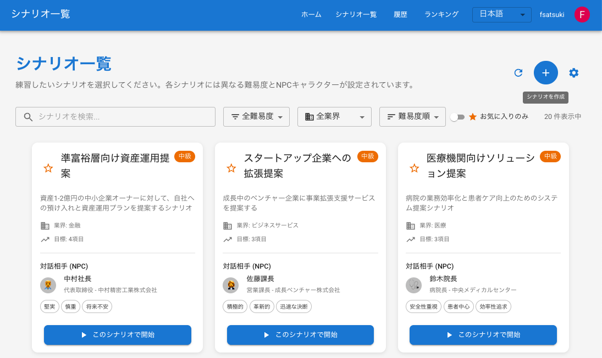
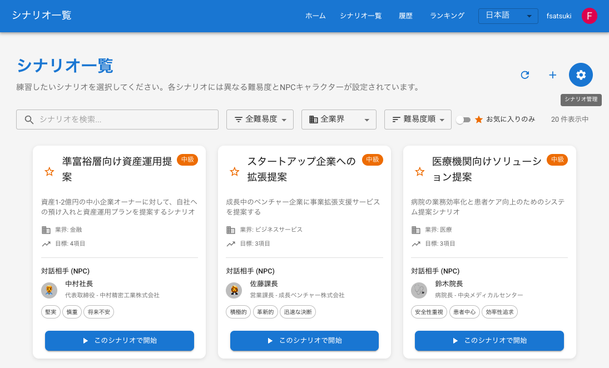
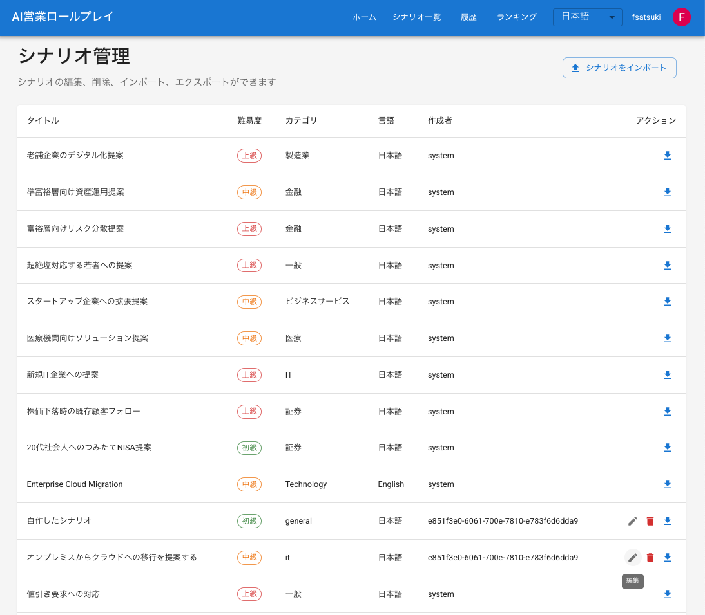

# 场景创建功能文档

## 概述

场景创建功能允许用户创建、编辑和删除自定义场景。可灵活创建多样化的销售场景，实现用户独有的训练场景。

## 功能说明

### 场景创建功能

场景创建由6个步骤组成

1. **基本信息**
   - 标题（必填，3～100字）
   - 说明（必填，10～1000字）
   - 难度（简单、普通、困难、专家级）
   - 类别（一般、IT、金融、医疗、零售、制造业等）

2. **NPC信息**
   - 姓名（必填，2～50字）
   - 职位（必填，最长100字）
   - 公司（必填，最长100字）
   - 性格特征（可多选）
   - 详细说明（可选）

3. **目标设置**
   - 初始指标（愤怒值、信任度、进度的初始值）
   - 目标列表（销售会话的目标）
   - 目标设定（必填/可选、优先级、达成条件）

4. **共享设置**
   - 公开范围（全部公开、不公开、与特定用户共享）
   - 共享目标用户（公开范围为「与特定用户共享」时）
   - Guardrail设置（合规规则集）

5. **销售资料·评估设置**
   - **销售资料上传**: 以PDF上传用于销售的资料，如商品手册、价格表、条款等（最多5个）
   - **自动评估功能**: 基于上传的资料，在销售会话后自动评估发言内容的准确性
   - **参考核对**: 确认用户的发言是否与资料内容一致，并指出不准确的信息
   - **具体示例**: 
     - ✅ 恰当: 「利率为1.2%」（资料中记载为1.2%）
     - ⚠️ 需改善: 「利率大概在1-2%左右」（资料中准确记载为1.2%）
     - ❌ 问题: 「癌症保险也涵盖皮肤癌」（资料中记载皮肤癌不在保障范围内）

6. **预览**
   - 整体确认所创建的场景
   - 保存前的最终确认

### 场景编辑功能

已创建的场景之后可以编辑。不过，根据场景类型不同，编辑权限也有所不同。

### 场景删除功能

不需要的场景可以删除。不过，系统场景无法删除。

## 场景的权限管理

场景分为3种类型，各自的编辑·删除权限有所不同。

### 场景的类型

| 类型 | `createdBy` | 说明 |
|---|---|---|
| 系统场景 | `system` | CDK部署时从 `scenarios.json` 自动注册的场景。演示用场景等属于此类 |
| 默认场景 | （无） | `isCustom` 为 `false` 的既有场景。仅允许所有用户更新提案资料 |
| 自定义场景 | 用户ID | 用户创建的场景。仅创建者可编辑·删除 |

### 权限矩阵

| 操作 | 系统场景 | 默认场景 | 自定义场景（本人） | 自定义场景（他人） |
|---|---|---|---|---|
| 浏览·试玩 | 所有用户 | 所有用户 | 取决于公开设置 | 取决于公开设置 |
| 全字段编辑 | 仅管理员 | 不可 | 可以 | 不可 |
| 更新提案资料 | 仅管理员 | 所有用户 | 可以 | 不可 |
| 删除 | 不可 | 不可 | 可以 | 不可 |

### 管理员角色

编辑系统场景需要管理员权限（Cognito `admin` 组）。

#### 管理员组的工作机制

- CDK部署时会在 Cognito User Pool 中自动创建 `admin` 组
- 后端（Lambda）根据 ID令牌的 `cognito:groups` 声明判断管理员身份
- 前端参照 ID令牌的 `cognito:groups` 声明，控制编辑按钮的显示

#### 添加管理员用户的方法

使用 AWS CLI 将用户添加到 `admin` 组。

```bash
aws cognito-idp admin-add-user-to-group \
  --user-pool-id <USER_POOL_ID> \
  --username <USERNAME_OR_EMAIL> \
  --group-name admin
```

通过 AWS Console 添加时:
1. 打开 Amazon Cognito 控制台
2. 选择目标 User Pool
3. 在「用户」选项卡中选择目标用户
4. 在「组」选项卡中选择「将用户添加到组」
5. 选择 `admin` 组并添加

#### 查看管理员的方法

```bash
# グループに所属するユーザー一覧を取得
aws cognito-idp list-users-in-group \
  --user-pool-id <USER_POOL_ID> \
  --group-name admin
```

#### 删除管理员的方法

```bash
aws cognito-idp admin-remove-user-from-group \
  --user-pool-id <USER_POOL_ID> \
  --username <USERNAME_OR_EMAIL> \
  --group-name admin
```

## 使用方法

### 创建场景

可以使用自然语言自由创建场景








新建场景时，请在场景列表页面点击「创建场景」按钮（+图标）。


### 编辑场景

更新已创建的场景时，请在场景列表页面点击「场景管理」按钮（齿轮图标）。


场景将显示在列表中。编辑时点击「编辑」按钮（铅笔图标），删除时点击「删除」按钮（垃圾桶图标）。  
场景仅创建者（所有者）可编辑。系统场景仅管理员（`admin` 组成员）可编辑，且无法删除。

